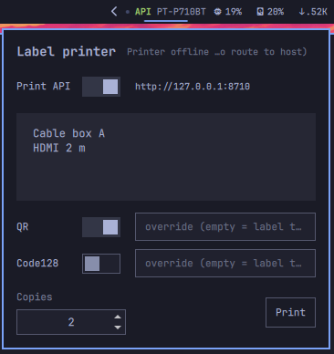

# OmaLabel — label printer for the Omarchy bar

Print labels on a Brother **PT-P710BT** (and other PT-series Bluetooth
printers) right from the Omarchy bar. A dot on the bar turns green while the
printer is connected; click it for the print popup: cassette status,
multiline label text, copies (1–100), and an optional QR code or Code128
barcode printed next to the text.

<p align="center"></p>

A **Print API** switch serves the printer over HTTP on `127.0.0.1`, so web
apps (for example an inventory system) can print labels through the same
printer without their own print agent.

## Install

1. Install the backend, [btprintbridge](https://github.com/stikkx/btprintbridge)
   (Python 3 with Pillow and qrcode — `sudo pacman -S python-pillow python-qrcode`):

   ```
   git clone https://github.com/stikkx/btprintbridge ~/.local/share/btprintbridge
   cd ~/.local/share/btprintbridge && ./install.sh
   ```

   This links the CLI to `~/.local/bin/btprintbridge`.

2. Install the plugin:

   ```
   omarchy plugin add https://github.com/stikkx/omarchy-labelprint --enable
   ```

3. Pair the printer over Bluetooth (`omarchy launch bluetooth` or
   `bluetoothctl`). The plugin uses the first paired device whose name starts
   with `PT-`; set `mac` in the widget settings if you have more than one.

Open the popup from a keybinding with
`qs ipc -p /usr/share/omarchy/shell call stikkx.labelprint toggle`.

To remove it: `omarchy plugin remove stikkx.labelprint`. If you used the
Print API, stop it first with the popup switch (or
`systemctl --user stop btprintbridge-api`).

## Backend

The plugin never talks to the printer itself — all printing goes through the
`btprintbridge` CLI. See *Install* above. If the backend binary is
missing, the popup cassette chip shows
"backend not found – run btprintbridge install.sh" and printing is refused.

## Usage

1. Pair the PT-P710BT over Bluetooth and load a cassette.
2. Add the **Label printer** widget to the bar (Devices category, right
   section). The dot turns green while the printer is connected.
3. Click the widget to open the popup:
   - Header chip shows the loaded cassette (`Cassette: 12 mm`) or the error
     reason (printer offline, etc.).
   - Multiline field: the label text. Sent exactly as typed — leading,
     trailing, and blank lines are printed as-is.
   - **QR / Code128** rows: flip the switch to print a QR code (left of the
     text) and/or a vertical Code128 barcode (right). The value field is an
     override; empty means the code encodes the label text itself.
   - **Preset**: *Text* (free text, optional QR / Code128) or *vCard*
     (Name, Email, Phone → contact QR code that phone cameras offer to save,
     with your label text next to it — or Name / Email / Phone when the
     text field is empty).
   - **Font**: `0` = auto (as large as fits), or a size in dots; a size that
     does not fit is shrunk.
   - **Preview**: the label as it will print (rendered by btprintbridge),
     with its length; errors (e.g. an invalid email) show here.
   - **Copies**: 1–100; each copy is cut separately.
4. Hit **Print**. A notification reports the printed label count or the
   backend's error reason. The popup can be closed freely; the last label and
   settings persist automatically.

## Print API (for web apps)

The popup's **Print API** switch runs `btprintbridge serve` as the transient
user unit `btprintbridge-api`, listening on `http://127.0.0.1:<apiPort>`
(default 8710). While it runs the bar shows a green **API** tag next to the
dot. Web apps print through it with the same backend, lock and printer
settings as the popup — BinaryStock's "Print" button uses it directly.

- **API key:** printing needs the key (`Authorization: Bearer <key>`).
  Press **Copy key** next to the switch and paste it into the web app's print
  settings. The key is created on first start in
  `~/.config/btprintbridge/api-key` (only readable by you); make a new one
  with `btprintbridge api-key --rotate`, then switch the API off and on.
- Only origins listed in `apiOrigins` may call it from a browser; requests
  from other sites or with a non-loopback `Host` are refused.
- The unit survives shell reloads; when the switch is on, the plugin
  re-starts it at shell start (after login) and restarts it when port,
  origins, MAC, channel or backend change.
- Manual control: `systemctl --user status|stop btprintbridge-api`,
  logs: `journalctl --user -u btprintbridge-api`.
- API reference: the [btprintbridge README](https://github.com/stikkx/btprintbridge#readme).

## Settings

Configured from the shell's widget settings (stored in `shell.json`):

| Key             | Type   | Default                   | Meaning                              |
|-----------------|--------|---------------------------|--------------------------------------|
| `mac`           | string | (empty)                   | Printer MAC address (empty = first paired `PT-*` printer) |
| `channel`       | string | `auto`                    | RFCOMM channel; `auto` finds it (some units use 2) |
| `backend`       | string | `~/.local/bin/btprintbridge` | Backend CLI command              |
| `copies`        | number | `1`                       | Default copies                       |
| `label`         | string | (empty)                   | Last label text                      |
| `qrEnabled`     | bool   | `false`                   | Print QR code with the label         |
| `qrValue`       | string | (empty)                   | QR value override (empty = label text) |
| `barcodeEnabled`| bool   | `false`                   | Print Code128 barcode with the label |
| `barcodeValue`  | string | (empty)                   | Barcode value override (empty = label text) |
| `apiEnabled`    | bool   | `false`                   | Run the Print API (popup switch)     |
| `apiPort`       | number | `8710`                    | Print API port                       |
| `apiOrigins`    | string | `http://localhost:3000`   | Browser origins allowed to call the API |

## Troubleshooting

- **"backend not found – run btprintbridge install.sh"** — the backend CLI is
  missing at the configured `backend` path. Run the
  backend's `install.sh` (see *Install*), or point the `backend` setting at the
  CLI's actual location.
- **"Printer offline …" / print errors mentioning the device** — the printer
  is not connected. Power it on and confirm pairing with
  `bluetoothctl info <mac>`; the bar dot should go green within ~5 s.
- **Printer busy / job rejected** — only one Bluetooth print job can run at a
  time. Wait for the previous print to finish (the popup shows "Printing…"),
  then retry.
- **"barcode cannot encode …"** — Code128 only holds plain ASCII. With an
  empty override the barcode uses the label text with its lines joined by
  spaces, so umlauts/emoji in the label break it: set an ASCII barcode value
  or turn the barcode off. The QR code accepts any text (multi-line, umlauts)
  and stores the label exactly as typed.
- **Label did not come out as expected** — run the backend directly to see the
  raw error: `~/.local/bin/btprintbridge status --mac <mac> --channel 1 --json`.
- **Print API switch shows "not running" or an error** — usually the port is
  in use by another program. Check `journalctl --user -u btprintbridge-api`
  and pick a free `apiPort`.

## License

MIT — see [LICENSE](LICENSE).
